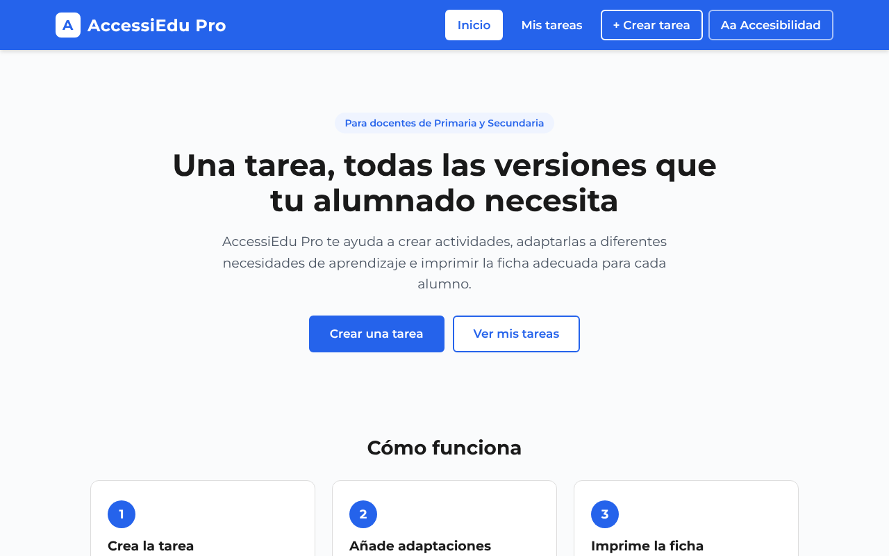
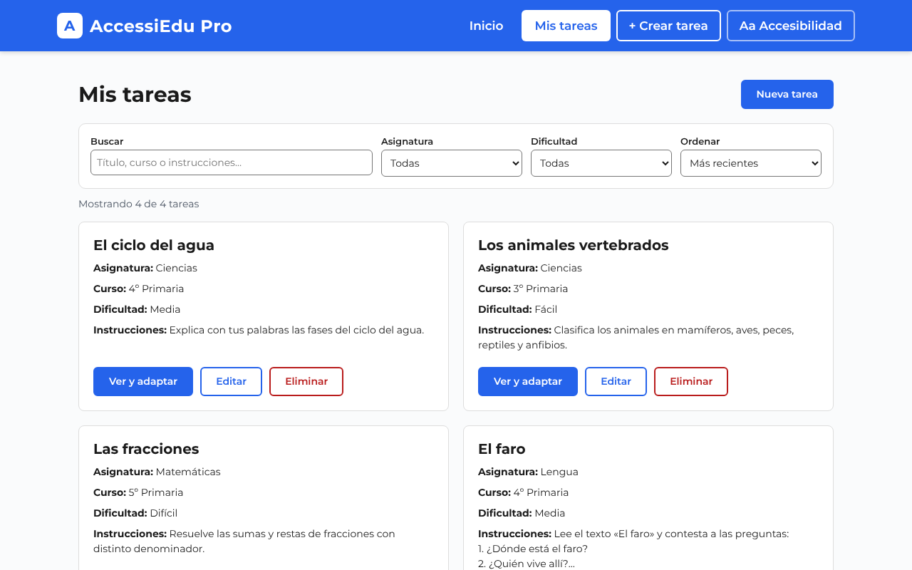
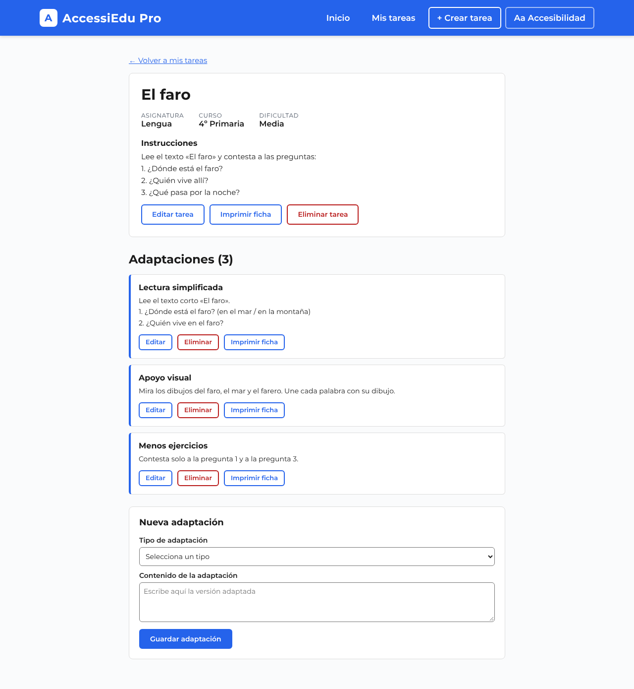
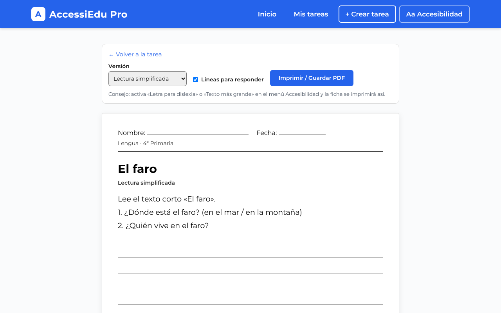
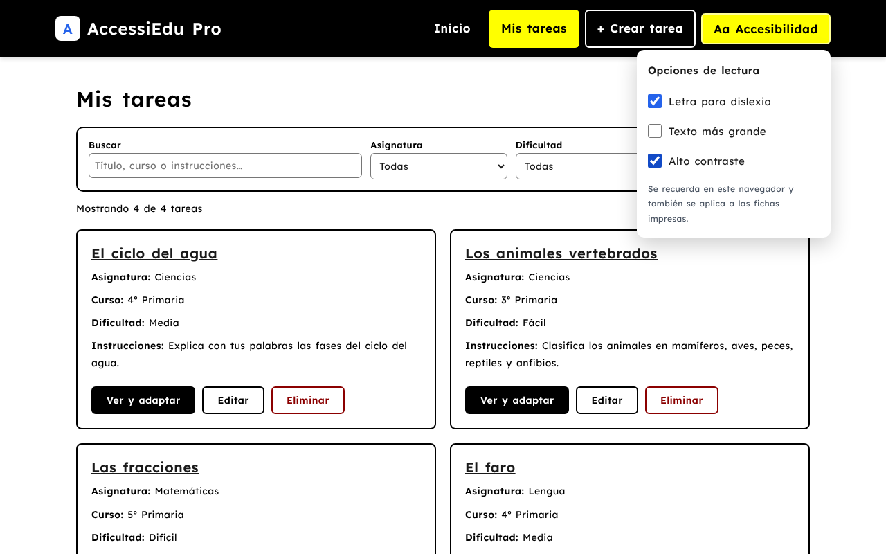

# AccessiEdu Pro

**Una tarea, todas las versiones que tu alumnado necesita.**
*One task, every version your students need.*

[](https://github.com/MAIALENSARASOLA/AccessiEdu-Pro/actions/workflows/ci.yml)

**Demo:** https://accessiedu-pro.netlify.app · **API:** https://accessiedu-pro-backend.onrender.com · **Backend repo:** [AccessiEdu-Pro-backend](https://github.com/MAIALENSARASOLA/AccessiEdu-Pro-backend)

> El backend está en el plan gratuito de Render y se duerme si nadie lo usa: la primera carga puede tardar hasta un minuto.
> *The backend runs on Render's free plan, so the first request may take up to a minute.*



[Español](#español) · [English](#english)

---

## Español

### Por qué lo hice

Soy maestra de Pedagogía Terapéutica, y sé lo que cuesta adaptar una misma ficha para varios alumnos. Muchas veces se hace a mano, tarea por tarea, y acabas con la misma ficha en cuatro archivos. Con AccessiEdu Pro creas la tarea una vez, le añades las adaptaciones que necesita cada alumno (lectura simplificada, apoyo visual, menos ejercicios…) e imprimes la versión adecuada.

### Qué se puede hacer

- **Tareas:** crear, ver, editar y borrar (título, asignatura, curso, dificultad e instrucciones).
- **Adaptaciones:** cada tarea tiene su propia página con todas sus versiones adaptadas, que se pueden añadir, editar y borrar.
- **Fichas imprimibles:** eliges la versión (original o una adaptación) y la imprimes o la guardas en PDF, con espacio para el nombre, la fecha y líneas para responder.
- **Buscador y filtros:** busca por texto (sin importar las tildes), filtra por asignatura y dificultad, y ordena.
- **Opciones de accesibilidad:** letra para dislexia ([Lexend](https://www.lexend.com/)), texto más grande y alto contraste. Se recuerdan en el navegador y también se aplican a las fichas impresas.
- **Accesible por diseño:** enlace «Saltar al contenido», se usa entero con teclado, mensajes que leen los lectores de pantalla, y 0 errores en la auditoría automática [axe](https://github.com/dequelabs/axe-core) (WCAG 2 A/AA).
- **Seguro ante errores:** confirmación antes de borrar, validación en el navegador y en el servidor, mensajes de error claros y aviso mientras el servidor se despierta.
- **Responsive:** funciona en el móvil.

| Mis tareas | Detalle con adaptaciones |
|---|---|
|  |  |

| Ficha para imprimir | Letra para dislexia + alto contraste |
|---|---|
|  |  |

### Con qué está hecho

- **Frontend:** React 16, React Router, Axios y SCSS. Desplegado en Netlify.
- **Backend:** Python, Flask, Flask-SQLAlchemy y Flask-CORS, con Gunicorn. Desplegado en Render.
- **Base de datos:** PostgreSQL en Neon en producción y SQLite en local.
- **Calidad:** tests con pytest (API) y con el test runner de Node (búsqueda y filtros), GitHub Actions en los dos repos.

### Cómo funciona por dentro

```
React (Netlify) → Axios → API REST de Flask (Render) → SQLAlchemy → PostgreSQL (Neon)
```

Hay dos tablas:
- `Task`: id, title, subject, course, difficulty, instructions
- `Adaptation`: id, task_id (clave foránea a Task), type, content

Las separé porque una tarea puede tener varias adaptaciones (relación uno a muchos).

Estructura del frontend:

```
src/
├── api.js                    # todas las llamadas a la API en un sitio
├── app.js                    # rutas y estado de las tareas
├── components/               # NavBar, TaskCard, AdaptationItem, AccessibilityMenu
├── pages/                    # Home, Dashboard, CreateTask, TaskDetail, PrintTask
├── utils/                    # filtros de tareas y preferencias de accesibilidad
└── style/main.scss
```

### Lo que aprendí por mi cuenta

En el curso desplegamos en Heroku y trabajamos con SQLite y MySQL. Aquí tuve que aprender a desplegar en Netlify y Render, a usar PostgreSQL en Neon y a pasar la conexión con una variable de entorno (`DATABASE_URL`), para no dejar la contraseña en el código.

No lo tenía planeado. Lo cambié cuando vi que en Render las tareas se borraban, porque el disco del plan gratis no guarda los datos. Con SQLite, cada vez que el servidor se reiniciaba, la base de datos volvía a estar vacía.

### Arrancarlo en local

```
git clone https://github.com/MAIALENSARASOLA/AccessiEdu-Pro.git
cd AccessiEdu-Pro
npm install
npm start      # http://localhost:3000
npm test       # tests de búsqueda y filtros
```

Con Node 17 o superior, antes de `npm start` o `npm run build` hace falta `export NODE_OPTIONS=--openssl-legacy-provider` (la plantilla usa webpack 4).

El backend tiene sus propias instrucciones en [su repositorio](https://github.com/MAIALENSARASOLA/AccessiEdu-Pro-backend).

### Historia del proyecto

1. **Capstone (octubre de 2026):** CRUD de tareas y adaptaciones, despliegue en Netlify, Render y Neon. Nota final: 94,3 %.
2. **Mejoras del feedback del profesor:** página de detalle, CRUD de adaptaciones, confirmación antes de borrar, redirección tras guardar y una barra de navegación más clara.
3. **Versión actual:** validación en el servidor, tests automáticos, fichas imprimibles, buscador y filtros, y opciones de accesibilidad.

### Uso de IA

Igual que en la entrega del Capstone, quiero ser transparente: usé un asistente de IA durante el desarrollo. Las mejoras posteriores a la evaluación (pasos 2 y 3 de la historia) se programaron con ayuda de IA, y yo las he revisado, probado y estudiado. La idea, las decisiones de producto y el conocimiento del aula son míos.

### Próximos pasos

- Inicio de sesión, para que cada docente vea solo sus tareas.
- Plantillas de adaptación reutilizables.

---

## English

AccessiEdu Pro is a full-stack web app that helps primary and secondary school teachers create a task once, store several adapted versions of it for students with different learning needs (dyslexia, ADHD, autism…), and print the right worksheet for each student.

I'm a special education teacher, and I built it to solve a problem I have every week: keeping the same worksheet in four different files.

**Features**

- Full CRUD for tasks and their adaptations, each task with its own detail page.
- Printable worksheets (or save as PDF): pick the original or an adapted version, with name/date fields and answer lines.
- Accent-insensitive search, filters by subject and difficulty, and sorting.
- Reading options: dyslexia-friendly font (Lexend), larger text and high contrast. They are saved per browser and also apply to printed worksheets.
- Accessible by design: skip link, full keyboard support, screen-reader status messages, and zero violations in an automated axe audit (WCAG 2 A/AA).
- Server-side validation with clear JSON errors, delete confirmations, and a loading notice while the free server wakes up.
- Responsive layout.

**Stack:** React 16, React Router, Axios, SCSS (Netlify) · Python, Flask, SQLAlchemy, Gunicorn (Render) · PostgreSQL on Neon (SQLite locally) · pytest, Node test runner and GitHub Actions.

**Architecture:** `React → Axios → Flask REST API → SQLAlchemy → PostgreSQL`, with two tables in a one-to-many relationship: `Task` and `Adaptation` (`task_id` foreign key).

**AI use:** I used an AI assistant during development. The post-evaluation improvements were written with AI help, and I reviewed, tested and studied them. The product idea, the decisions and the classroom knowledge are mine.

---

Maialen Sarasola · Capstone, Full Stack Development with JavaScript, Python and React · [GitHub](https://github.com/MAIALENSARASOLA)
